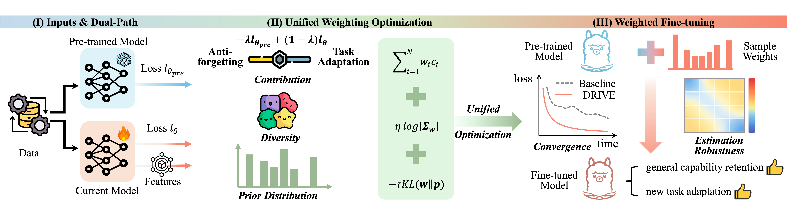

# DRIVE: Fine-tuning via Data Contribution- and Diversity-aware Weighting with Prior Regularization

**DRIVE** is a novel weighting methodology proposed to address catastrophic forgetting when fine-tuning without access to the original training data. While current methods lack an effective mechanism to acquire new task-specific information while preserving prior knowledge, DRIVE assesses each sample's contribution toward enabling adaptation and preventing forgetting through a tunable parameter. By jointly optimizing sample diversity within the weighting objective, DRIVE effectively addresses the stability-plasticity dilemma, identifying redundancy to ensure structural coverage.


## Core Innovations of DRIVE

- **Unified weighting Framework:** We propose DRIVE, a novel weighting framework that jointly reformulates components rather than off-the-shelf aggregation. Shapley additivity yields an anti-forgetting and task-adaptation decomposition; a covariance-determinant term renders diversity differentiable, to our knowledge the first such a term for sample weighting; and KL anchors weights to a sample-characteristic prior.


- **Theoretical Guarantees on Convergence and Robustness:** We develop a provably convergent iterative solver for the coupled DRIVE objective. Theoretical analysis in linear/local nonlinear regimes shows contribution decomposition tightens the stability--plasticity trade-off, while diversity provably accelerates convergence and enhances robustness.

- **Comprehensive Empirical Validation:** Across vision models and LLMs, DRIVE consistently outperforms strong baselines, with better overall performance, faster convergence, and stronger robustness.

## Requirements

**Hardware Requirements:**
- Four A100 80G GPU (Recommended for LLM experiments)

**Software Dependencies:**
```bash
torch==2.5.1
transformers==4.48.1
accelerate==1.3.0
peft==0.14.0
datasets==3.1.0
numpy==1.26.4
pandas==2.2.3
scikit-learn==1.5.2
scipy==1.14.1
wandb==0.18.7
tqdm==4.67.0
matplotlib==3.9.3
safetensors==0.4.5
PyYAML==6.0.2